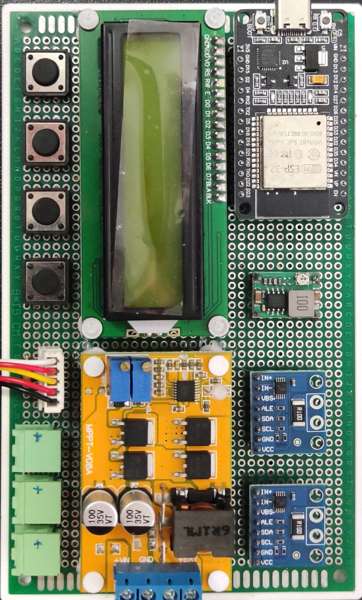
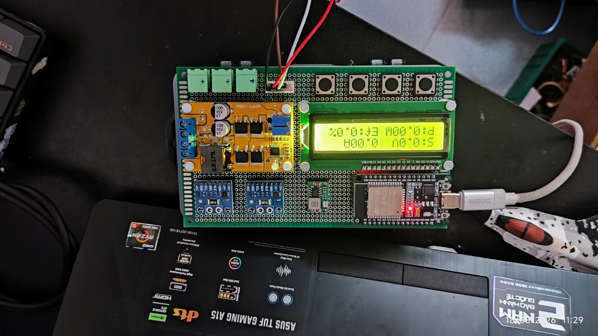
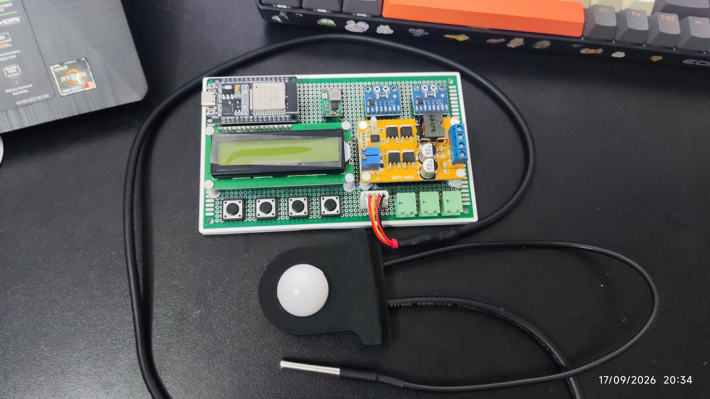
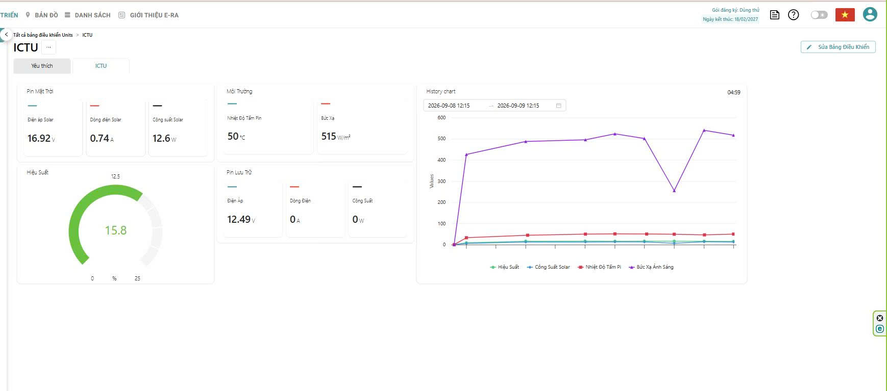
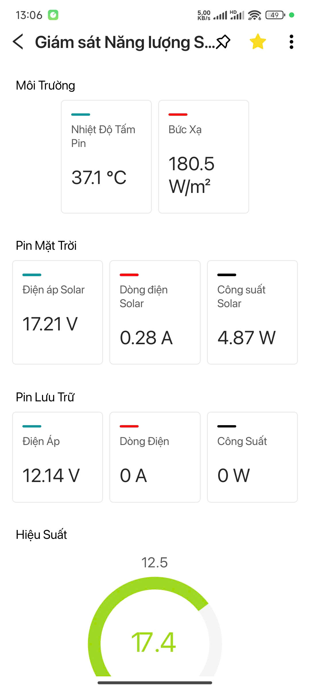
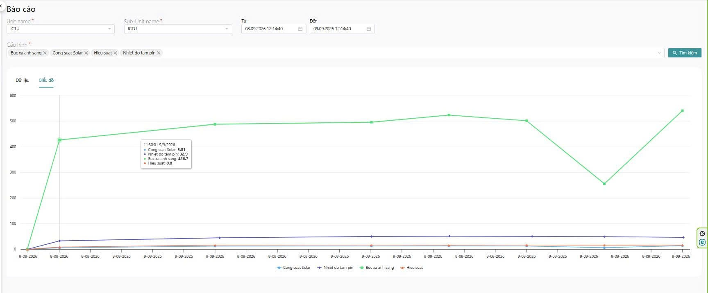
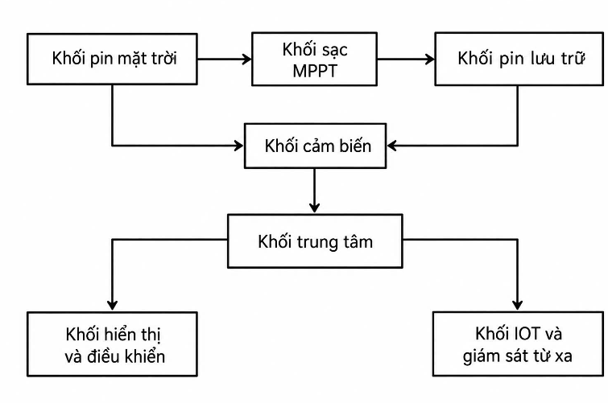
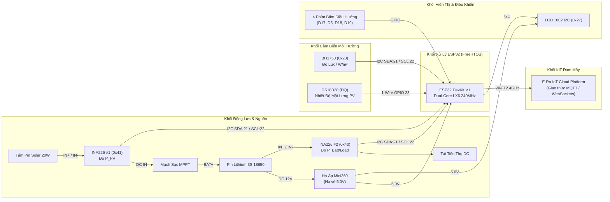
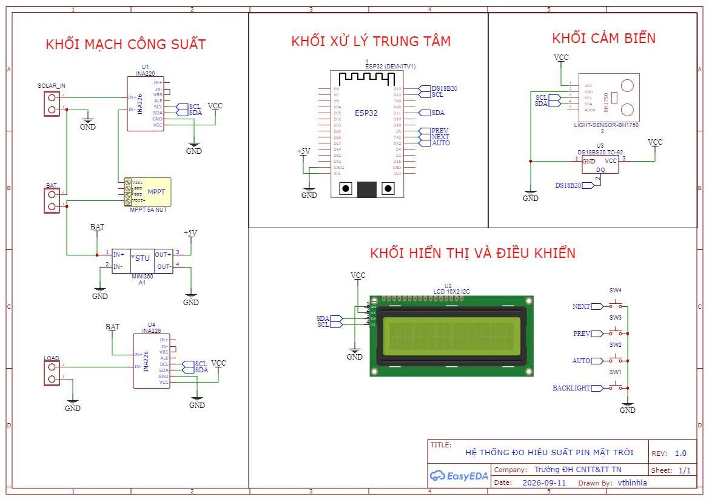

<div align="center">

# ☀️ Solar-Smart-IOT: Real-Time Dual-Channel Solar PV & Battery Storage Telemetry Station

[](LICENSE)
[](https://platformio.org/)
[](https://espressif.com/)
[](https://www.freertos.org/)
[](https://eoh.io/)
[](#-k%E1%BA%BFt-qu%E1%BA%A3-th%E1%BB%B1c-nghi%E1%BB%87m--ki%E1%BB%83m-ch%E1%BB%A9ng)

**Trạm IoT giám sát, thu thập và tính toán hiệu suất chuyển đổi quang - điện ($\eta\%$) theo thời gian thực cho hệ thống điện năng lượng mặt trời kết hợp bộ lưu trữ pin Lithium 3S.**

[Tổng Quan](#-t%E1%BB%95ng-quan-d%E1%BB%B1-%C3%A1n) • [Tính Năng](#-t%C3%ADnh-n%C4%83ng-ch%C3%ADnh) • [Kiến Trúc](#-ki%E1%BA%BFn-tr%C3%BAc-h%E1%BB%87-th%E1%BB%91ng) • [Phần Cứng & BOM](#-linh-ki%E1%BB%87n-ph%E1%BA%A7n-c%E1%BB%A9ng--bom) • [Mô Hình 3D](#-m%C3%B4-h%C3%ACnh-c%C6%A1-kh%C3%AD-3d-cad) • [Cài Đặt & Sử Dụng](#-h%C6%B0%E1%BB%9Bng-d%E1%BA%ABn-c%C3%A0i-%C4%91%E1%BA%B7t--n%E1%BA%A1p-firmware) • [Tài Liệu Chi Tiết](#-t%C3%A0i-li%E1%BB%87u-k%E1%BB%B9-thu%E1%BA%ADt)

---

### 📸 Hình Ảnh Trạm Đo Thực Tế & Giao Diện Giám Sát

| Bo Mạch Điều Khiển Hoàn Chỉnh | Trạm Đo Khi Đang Hoạt Động | Cụm Cảm Biến Môi Trường Ngoài Trời |
|:---:|:---:|:---:|
|  |  |  |

| Bảng Điều Khiển Web (E-Ra Dashboard) | Ứng Dụng Giám Sát Trên Điện Thoại | Biểu Đồ Lịch Sử Đo Đạc Thực Tế |
|:---:|:---:|:---:|
|  |  |  |

</div>

---

## 📖 Tổng Quan Dự Án

Trong các hệ thống điện mặt trời quy mô dân dụng và trạm vi lưới (Microgrid), sản lượng điện phát ra biến động liên tục theo điều kiện thời tiết (cường độ bức xạ mặt trời, nhiệt độ môi trường, góc chiếu, mây che và bụi bẩn bề mặt). Phương pháp đo kiểm thủ công bằng đồng hồ vạn năng hoặc thiết bị data logger đơn thuần không đáp ứng được yêu cầu giám sát từ xa tức thời và đánh giá mức độ suy giảm hiệu suất vận hành.

**Solar-Smart-IOT** là giải pháp phần cứng mở (Open-Source Hardware) và nhúng toàn diện:
1. **Thu thập đồng thời 2 kênh công suất độc lập:** Kênh 1 giám sát dòng điện, điện áp và công suất phát từ tấm pin PV đi vào bộ sạc MPPT; Kênh 2 giám sát quá trình nạp/xả của bộ lưu trữ pin Lithium 3S và công suất cấp tải.
2. **Đo vi khí hậu bề mặt tấm pin:** Thu thập cường độ ánh sáng quang học (Lux quy đổi sang $W/m^2$) và nhiệt độ mặt lưng tấm pin (°C).
3. **Tính toán động hiệu suất chuyển đổi tức thời ($\eta\%$):** Tự động tính toán tỷ số giữa công suất điện tạo ra và quang năng chiếu tới bề mặt hiệu dụng của tấm pin.
4. **Kiến trúc phần mềm FreeRTOS Dual-Core:** Core 0 phụ trách truyền dữ liệu nền MQTT lên E-Ra Cloud qua Wi-Fi; Core 1 đảm bảo việc đọc cảm biến và hiển thị giao diện LCD1602 mượt mà, độc lập hoàn toàn với trạng thái kết nối mạng.
5. **Cơ cấu cơ khí in 3D hoàn chỉnh:** Bao gồm đế gá mạch chính, hộp cảm biến ngoài trời chống nước tạt, trụ đỡ màn hình và nắp nút nhấn.

---

## ⚡ Tính Năng Chính

* 🔋 **Đo đạc công suất 2 kênh độ chính xác cao:** Sử dụng 2 cảm biến kỹ thuật số **INA226** (ADC 16-bit, điện trở Shunt $0.1\Omega$) đo độc lập nhánh pin mặt trời (`0x41`) và nhánh ắc quy/tải (`0x40`).
* ☀️ **Quan trắc bức xạ & nhiệt độ quang điện:** Cảm biến ánh sáng số **BH1750** (dải 1 - 65,535 lux) kết hợp đầu dò nhiệt độ chống nước **DS18B20** giao tiếp 1-Wire.
* 📊 **Tính toán hiệu suất ($\eta\%$) tức thời:** Thuật toán nhúng tự động lọc nhiễu thiếu sáng ($G < 10\text{ W/m}^2$) và kẹp giá trị biên chống lỗi chia cho 0.
* 🖥️ **Giao diện hiển thị LCD 1602 đa trang:** 5 trang màn hình chuyên biệt hiển thị điện áp, dòng điện, công suất, trạng thái nạp/xả, thông số môi trường, hiệu suất và kết nối.
* 🎛️ **Cụm 4 phím bấm vật lý:** Hỗ trợ phím NEXT (GPIO 17), PREV (GPIO 5), AUTOSCROLL (GPIO 18 - tự chuyển trang sau 5s) và BACKLIGHT (GPIO 19 - tắt đèn nền tiết kiệm pin).
* 🌐 **Đồng bộ đám mây E-Ra IoT qua MQTT:** Truyền dữ liệu lên 9 chân ảo (Virtual Pins V0 - V8) mỗi 2 giây, cho phép theo dõi trực quan trên Web và App di động (iOS/Android).
* 🛡️ **Vận hành cục bộ tin cậy (Offline-First):** Khi mất kết nối Wi-Fi, trạm đo vẫn hoạt động bình thường và hiển thị đầy đủ thông số tại chỗ trên màn hình LCD.

---

## 🏗️ Kiến Trúc Hệ Thống

### Sơ Đồ Khối Chức Năng (System Block Diagram)





---

## 🔌 Sơ Đồ Đấu Nối & Bảng Chân Kết Nối (Wiring Matrix)



| Chân ESP32 | Tín Hiệu | Thiết Bị Ngoại Vi | Chức Năng & Lưu Ý Kỹ Thuật |
|:---:|:---:|:---|:---|
| **GPIO 21** | `SDA` | INA226 Solar (`0x41`), INA226 Batt (`0x40`), BH1750 (`0x23`), LCD1602 (`0x27`) | Tuyến bus I2C dữ liệu dùng chung (Kéo lên 3.3V) |
| **GPIO 22** | `SCL` | INA226 Solar (`0x41`), INA226 Batt (`0x40`), BH1750 (`0x23`), LCD1602 (`0x27`) | Tuyến bus I2C xung nhịp dùng chung |
| **GPIO 23** | `DATA` | Cảm biến nhiệt độ DS18B20 (Dây vàng/trắng) | Tuyến 1-Wire (**Bắt buộc trở kéo $4.7\text{ k}\Omega$ lên 3.3V**) |
| **GPIO 17** | `NEXT` | Nút nhấn SW1 (Trang kế tiếp) | `INPUT_PULLUP`, tích cực mức thấp (nối GND khi nhấn) |
| **GPIO 5** | `PREV` | Nút nhấn SW2 (Trang trước đó) | `INPUT_PULLUP`, tích cực mức thấp (nối GND khi nhấn) |
| **GPIO 18** | `AUTO` | Nút nhấn SW3 (Bật/Tắt tự động cuộn trang) | `INPUT_PULLUP`, tích cực mức thấp (nối GND khi nhấn) |
| **GPIO 19** | `LIGHT`| Nút nhấn SW4 (Bật/Tắt đèn nền LCD) | `INPUT_PULLUP`, tích cực mức thấp (nối GND khi nhấn) |
| **5V / VIN**| `VCC` | Module hạ áp Mini360 (OUT+) | **Cấp nguồn 5.00V chính xác** nuôi ESP32 và LCD1602 |
| **GND** | `GND` | Toàn bộ linh kiện và nguồn âm | Điểm nối đất tham chiếu chung (Common Ground) |

👉 *Xem chi tiết sơ đồ nguyên lý và lưu ý an toàn tại:* [`docs/wiring.md`](docs/wiring.md)

---

## 📋 Linh Kiện Phần Cứng & BOM

| STT | Tên Linh Kiện | Thông Số Kỹ Thuật | Số Lượng | Đơn Giá (VNĐ) | Trạng Thái |
|:---:|:---|:---|:---:|:---:|:---:|
| 1 | **Tấm pin năng lượng mặt trời** | 20W Polycrystalline (Voc: 22V, Vmp: 17.5V, Imp: 1.14A) | 1 | 250.000 | Đã kiểm thử |
| 2 | **Vi điều khiển ESP32** | ESP32 DevKit V1 30-pin (Dual-Core 240MHz, 4MB Flash) | 1 | 95.000 | Đã kiểm thử |
| 3 | **Cảm biến dòng/áp INA226 (x2)** | ADC 16-bit, Shunt 0.1Ω (Địa chỉ `0x41` và `0x40`) | 2 | 90.000 | Đã kiểm thử |
| 4 | **Cảm biến ánh sáng BH1750** | Dải 1 - 65,535 lux, giao tiếp I2C (`0x23`) | 1 | 35.000 | Đã kiểm thử |
| 5 | **Cảm biến nhiệt độ DS18B20** | Dây chống nước, vỏ inox, dải -55°C đến +125°C | 1 | 35.000 | Đã kiểm thử |
| 6 | **Màn hình LCD 1602 I2C** | 16 ký tự x 2 dòng, tích hợp chip chuyển đổi PCF8574 | 1 | 45.000 | Đã kiểm thử |
| 7 | **Mạch sạc MPPT Solar** | Module sạc năng lượng mặt trời cho pin Lithium 3S | 1 | 85.000 | Đã kiểm thử |
| 8 | **Khối pin lưu trữ 3S** | Bộ pin 3S 18650 (11.1V danh định) kèm mạch BMS | 1 | 150.000 | Đã kiểm thử |
| 9 | **Module hạ áp Mini360** | MP1584EN, hiệu suất 92%, chỉnh áp về 5.00V | 1 | 15.000 | Đã kiểm thử |
| 10 | **Nút nhấn & phụ kiện** | 4 nút tact switch, trở kéo 4.7kΩ, tụ lọc nguồn, cọc vít KF301 | 1 bộ | 40.000 | Đã kiểm thử |
| 11 | **Chi tiết in 3D nhựa PETG** | Đế gá mạch, hộp cảm biến, nắp hộp, 4 trụ LCD, 4 núm bấm | 5 món | 50.000 | Đã gia công |
| **TỔNG**| | **Tổng chi phí hoàn thiện 01 trạm đo** | | **~890.000 VNĐ** | (~$35 USD) |

👉 *Xem chi tiết bảng kê vật tư và đơn giá từng linh kiện tại:* [`docs/bom.md`](docs/bom.md)

---

## 🖨️ Mô Hình Cơ Khí 3D CAD

Toàn bộ các tệp mô hình 3D sẵn sàng in (.STL / .3MF) và file thiết kế gốc Autodesk Fusion 360 (.F3D) được cung cấp trong [`hardware/mechanical/`](hardware/mechanical/):

* [`Base_Plate_De_Mach.stl`](hardware/mechanical/3d_models/Base_Plate_De_Mach.stl) — Tấm đế gá bo mạch chính (154.30 × 94.20 × 6.00 mm).
* [`Sensor_Housing.stl`](hardware/mechanical/3d_models/Sensor_Housing.stl) — Hộp bảo vệ cảm biến ngoài trời (60.00 × 65.00 × 22.00 mm).
* [`Sensor_Lid.stl`](hardware/mechanical/3d_models/Sensor_Lid.stl) — Nắp đậy hộp cảm biến (39.80 × 44.80 × 19.80 mm).
* [`LCD_Standoff_Pillars.stl`](hardware/mechanical/3d_models/LCD_Standoff_Pillars.stl) — Bộ 4 trụ đỡ màn hình LCD1602 (6.90 × 6.90 × 12.30 mm).
* [`Button_Cap_NUTz.stl`](hardware/mechanical/3d_models/Button_Cap_NUTz.stl) — Bộ 4 nắp chụp phím bấm điều hướng (4.90 × 4.90 × 5.00 mm).
* [`Sensor_Housing_Parametric.f3d`](hardware/mechanical/cad_source/Sensor_Housing_Parametric.f3d) — File CAD tham số gốc Autodesk Fusion 360.

👉 *Xem hướng dẫn in 3D và thông số slicer tại:* [`hardware/mechanical/specifications.md`](hardware/mechanical/specifications.md) & [`docs/assembly.md`](docs/assembly.md)

---

## 🚀 Hướng Dẫn Cài Đặt & Nạp Firmware

### 1. Cài đặt PlatformIO
Khuyến nghị sử dụng **VS Code** với tiện ích mở rộng **PlatformIO IDE**.

### 2. Tải mã nguồn về máy
```bash
git clone https://github.com/vthinh-la/Solar-Smart-IOT.git
cd Solar-Smart-IOT
```

### 3. Cấu hình thông tin Wi-Fi và E-Ra Token
Mở tệp [`src/config.h`](src/config.h) (hoặc nhân bản từ [`src/config.example.h`](src/config.example.h)) và cập nhật:

```cpp
#define ERA_AUTH_TOKEN "DIEN_AUTH_TOKEN_ERA_CUA_BAN"
#define WIFI_SSID      "TEN_WIFI_NHA_BAN"
#define WIFI_PASS      "MAT_KHAU_WIFI"
#define PANEL_AREA_M2  0.155f // Diện tích bề mặt cell quang điện (m²)
```

### 4. Biên dịch và nạp lên ESP32
```bash
# Biên dịch mã nguồn
pio run

# Cắm cáp USB và nạp firmware lên bo ESP32
pio run --target upload

# Theo dõi dữ liệu Serial thời gian thực (Baud rate 115200)
pio device monitor
```

---

## 🔬 Kết Quả Thực Nghiệm & Kiểm Chứng

Hệ thống đã trải qua đợt kiểm thử thực tế ngoài trời tại TP. Thái Nguyên (ngày 09/09/2026). Dưới đây là bảng trích xuất dữ liệu đo thực tế từ E-Ra Cloud:

| Thời Gian | Bức Xạ Mặt Trời ($G$ - $\text{W/m}^2$) | Công Suất Phát ($P_{\text{PV}}$ - $\text{W}$) | Hiệu Suất Tức Thời ($\eta\%$) | Nhiệt Độ Tấm Pin ($T_{\text{Panel}}$ - $^\circ\text{C}$) | Ghi Chú |
|:---:|:---:|:---:|:---:|:---:|:---|
| 11:30 | 426.7 | 5.81 | 8.8% | 32.9 | Khởi động hệ thống |
| 11:40 | 488.0 | 12.52 | 16.5% | 44.8 | Nắng đều, MPPT ổn định |
| 11:50 | 496.0 | 12.91 | 16.8% | 50.0 | Nắng gắt, hiệu suất cao nhất |
| 11:55 | 523.9 | 13.22 | 16.3% | 51.2 | Đỉnh bức xạ đợt 1 |
| 12:00 | 501.9 | 12.97 | 16.7% | 50.4 | Trạng thái ổn định |
| **12:05** | **255.7** | **6.53** | **16.5%** | **49.5** | **Mây che đột ngột (Bức xạ giảm 49%)** |
| **12:10** | **541.0** | **13.79** | **16.4%** | **46.4** | **Đỉnh công suất thử nghiệm (13.79W)** |
| 12:15 | 517.4 | 12.66 | 15.8% | 50.2 | Hiệu suất duy trì ổn định |

### Nhận Xét Kỹ Thuật:
1. **Phản ứng tức thì với mây che:** Tại mốc 12:05, bức xạ giảm $49.0\%$ và công suất phát giảm tương ứng $49.6\%$. Hiệu suất tính toán vẫn giữ mức $16.5\%$, chứng minh thuật toán bám sát biến thiên quang thông thực tế.
2. **Hiệu suất quang - điện phù hợp lý thuyết:** Dải hiệu suất đo được ($15.8\% \div 16.8\%$) hoàn toàn trùng khớp với dải hiệu suất thiết kế danh định của pin mặt trời Polycrystalline ($15\% \div 18\%$).

👉 *Xem toàn bộ biểu đồ và phân tích chuyên sâu tại:* [`docs/testing.md`](docs/testing.md)

---

## 📚 Tài Liệu Kỹ Thuật

| Tài Liệu | Nội Dung Chính |
|:---|:---|
| 🏗️ [**Architecture Guide**](docs/architecture.md) | Kiến trúc 4 tầng IoT, kiến trúc FreeRTOS đa nhiệm 2 lõi, luồng năng lượng và công thức tính toán. |
| 📋 [**Bill of Materials (BOM)**](docs/bom.md) | Bảng kê chi tiết từng linh kiện, thông số, mã đặt hàng, số lượng và giá cả thực tế. |
| 🔌 [**Wiring & Pinout Guide**](docs/wiring.md) | Sơ đồ nguyên lý mạch, ma trận chân ESP32, bản đồ địa chỉ I2C và quy tắc an toàn. |
| 🛠️ [**Assembly Guide**](docs/assembly.md) | Quy trình in 3D, gia công bo mạch, hiệu chỉnh Mini360 5.0V và checklist trước khi cấp nguồn. |
| 🧪 [**Testing & Verification**](docs/testing.md) | Báo cáo kiểm thử tĩnh, kiểm thử phòng lab, số liệu thực nghiệm ngoài trời tại Thái Nguyên. |
| ⚠️ [**Known Issues & Limitations**](docs/known-issues.md) | Sai số quy đổi quang thông BH1750, hạn chế lưu trữ offline và lộ trình nâng cấp. |
| 📖 [**User Guide**](docs/user-guide.md) | Hướng dẫn vận hành, cấu hình tài khoản E-Ra Cloud, thiết lập widget và menu 4 nút LCD. |
| 📐 [**Mechanical Specifications**](hardware/mechanical/specifications.md) | Bảng kích thước hình học chính xác của các file STL và file nguồn Autodesk Fusion 360. |
| 📌 [**Pinout Reference**](hardware/schematics/pinout_reference.md) | Bảng tra cứu nhanh sơ đồ chân ESP32 và bus truyền thông. |

---

## 🗺️ Lộ Trình Phát Triển (Roadmap)

- [x] **v1.0 (Hiện tại):** Hoàn thiện phần cứng mô hình 20W, đa nhiệm FreeRTOS, hiển thị LCD1602 đa trang, giám sát E-Ra Cloud qua Wi-Fi MQTT.
- [ ] **v1.1:** Tích hợp module thẻ nhớ MicroSD lưu dữ liệu ngoại tuyến khi mất Internet; thêm IC thời gian thực RTC DS3231.
- [ ] **v1.2:** Tích hợp tính năng tự động ghi nhận sản lượng điện tích lũy ($Wh$) vào Flash NVS.
- [ ] **v2.0:** Bổ sung module SIM 4G LTE dự phòng; ứng dụng thuật toán Edge AI / TinyML dự báo sản lượng và phát hiện bề mặt pin bị bám bẩn.

---

## 👥 Đội Ngũ Tác Giả & Lời Tri Ân

Đề tài được nghiên cứu và thực hiện tại **Trường Đại học Công nghệ Thông tin và Truyền thông - Đại học Thái Nguyên (ICTU)**, Khoa Kỹ thuật và Công nghệ:

* **Sinh viên thực hiện:**
  1. **Lã Văn Thịnh** (Trưởng nhóm / Phần cứng & Nhúng) — [GitHub Profile](https://github.com/vthinh-la)
  2. Trần Văn Hoàng
  3. Nguyễn Phương Duy
  4. Phùng Thị Thúy Minh
  5. Nguyễn Mạnh Phương
* **Giảng viên hướng dẫn:** **TS. Phạm Thành Nam** (Bộ môn Kỹ thuật Điện tử - Viễn thông).

---

## 📄 Giấy Phép (License)

Dự án được phân phối dưới giấy phép mã nguồn mở **[MIT License](LICENSE)**. Bạn hoàn toàn tự do sử dụng, chỉnh sửa, nhân bản và ứng dụng cho mục đích cá nhân, học tập hoặc thương mại với điều kiện giữ nguyên thông tin tác giả và bản quyền.
