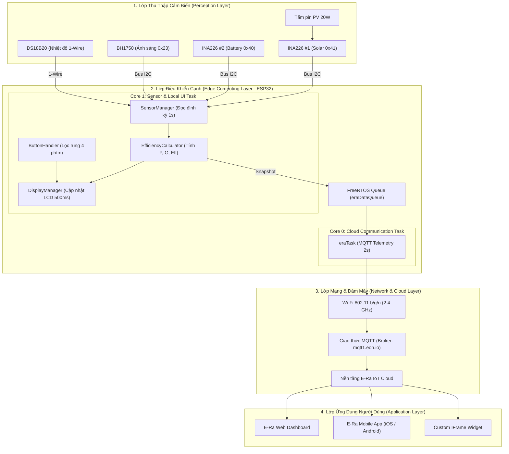

# 🏗️ System Architecture — Kiến Trúc Hệ Thống & Luồng Dữ Liệu

Tài liệu này phân tích chi tiết kiến trúc phần cứng, kiến trúc firmware đa nhiệm FreeRTOS, luồng năng lượng điện động lực và quy trình truyền thông IoT đám mây của hệ thống **Solar-Smart-IOT**.

---

## 1. Kiến Trúc Tổng Thể 4 Lớp IoT (IoT 4-Tier Architecture)

Hệ thống được thiết kế tuân thủ mô hình kiến trúc 4 lớp tiêu chuẩn công nghiệp:



---

## 2. Kiến Trúc Phần Cứng & Luồng Năng Lượng (Power Flow)


Hệ thống quản lý hai luồng năng lượng song song:
1. **Luồng thu hoạch năng lượng (Harvesting Path):** Quang năng mặt trời $\rightarrow$ Tấm pin PV (20W) $\rightarrow$ Đo đạc đầu vào bởi INA226 #1 $\rightarrow$ Mạch sạc MPPT tối ưu điểm công suất cực đại $\rightarrow$ Nạp năng lượng vào khối pin lưu trữ Lithium 3S 18650.
2. **Luồng phân phối và tiêu thụ (Distribution Path):** Khối pin lưu trữ (11.1V danh định) $\rightarrow$ Cung cấp cho mạch hạ áp Mini360 (hạ áp xuống 5.0V ổn định để nuôi ESP32 và màn hình LCD) đồng thời cấp điện qua cảm biến INA226 #2 đến tải tiêu thụ một chiều DC.

---

## 3. Kiến Trúc Đa Nhiệm FreeRTOS (Dual-Core Asynchronous Firmware)

Để loại bỏ hoàn toàn hiện tượng nghẽn giao diện người dùng (UI Freezing) khi mạng Wi-Fi gặp sự cố hoặc chờ bắt tay MQTT với đám mây, firmware áp dụng kiến trúc tách lõi vi xử lý **ESP32 Xtensa Dual-Core**:

```
+---------------------------------------------------------------------------------+
|                               ESP32 DUAL-CORE SOC                               |
|                                                                                 |
|  [ CORE 1: Real-time Control & UI ]      [ CORE 0: Network & Cloud Communication]
|                                                                                 |
|  +------------------------------+        +-----------------------------------+  |
|  | loop() - Priority: 1         |        | eraTask() - Priority: 1           |  |
|  | - buttonHandler.checkEvents()|        | - ERa.run() (Non-blocking loop)   |  |
|  | - sensorManager.readAll()    |        | - ERa.connected() check           |  |
|  | - displayManager.update()    |        | - xQueuePeek(eraDataQueue)        |  |
|  | - printSerialDebug()         |        | - sendDataToERa() (2s interval)   |  |
|  +--------------+---------------+        +-----------------+-----------------+  |
|                 |                                          ^                    |
|                 | xQueueOverwrite()                        |                    |
|                 +----------------> [ FreeRTOS Queue ] -----+                    |
|                                    (Size: 1 SolarData)                          |
+---------------------------------------------------------------------------------+
```

### Ưu điểm kỹ thuật của thiết kế:
* **Tách biệt hoàn toàn thời gian thực:** Quá trình quét phím 4 nút nhấn và cập nhật màn hình LCD1602 diễn ra mượt mà với chu kỳ 500ms tại Core 1, hoàn toàn không bị ảnh hưởng bởi độ trễ gói tin mạng TCP/IP ở Core 0.
* **Cơ chế Queue 1 phần tử (Overwrite):** Luôn đảm bảo tác vụ truyền thông E-Ra lấy được gói dữ liệu vi khí hậu mới nhất mà không gây tràn bộ nhớ đệm (RAM) hoặc trễ dữ liệu cũ.
* **Khả năng tự phục hồi (Auto-Reconnect):** Khi mất kết nối Wi-Fi hoặc Broker E-Ra ngắt kết nối, Core 0 tự động thử kết nối lại nền theo chu kỳ mà không làm khởi động lại ESP32.

---

## 4. Mô Hình Toán Học & Thuật Toán Tính Toán Hiệu Suất

Khối `EfficiencyCalculator` chịu trách nhiệm xử lý các phép biến đổi vật lý theo chu trình:

### 4.1. Công suất phát điện thực tế ($P_{\text{PV}}$)
Sử dụng giá trị điện áp bus ($U_{\text{PV}}$) và dòng điện ($I_{\text{PV}}$) đo từ cảm biến INA226 #1:
$$P_{\text{PV}} = U_{\text{PV}} \times |I_{\text{PV}}| \quad (\text{W})$$

### 4.2. Quy đổi mật độ bức xạ mặt trời ($G$)
Cảm biến quang học BH1750 đo độ rọi ánh sáng theo đơn vị Lux. Dựa trên nghiên cứu chuẩn về phổ ánh sáng mặt trời [Michael et al., 2020], hệ số chuyển đổi thực nghiệm được áp dụng:
$$G = \frac{\text{Lux}}{120.0} \quad (\text{W/m}^2)$$

### 4.3. Tổng công suất bức xạ tới bề mặt tấm pin ($P_{\text{in}}$)
Với diện tích hữu dụng của tấm pin năng lượng mặt trời $S = 0.155\text{ m}^2$ (kích thước đo đạc thực tế phần tế bào quang điện):
$$P_{\text{in}} = G \times S = \frac{\text{Lux}}{120.0} \times 0.155 \quad (\text{W})$$

### 4.4. Hiệu suất chuyển đổi quang - điện tức thời ($\eta$)
Hiệu suất chuyển đổi là tỷ số phần trăm giữa công suất điện một chiều thu được trên công suất quang năng chiếu tới:
$$\eta = \left( \frac{P_{\text{PV}}}{P_{\text{in}}} \right) \times 100\%$$

### 4.5. Xử lý điều kiện biên & Khử nhiễu:
* **Điều kiện thiếu sáng (Low Light Filter):** Khi $G < 10.0\text{ W/m}^2$ (trời tối, bóng râm sâu hoặc ban đêm), hệ thống tự động gán $\eta = 0.0\%$ và đặt cờ `efficiency_valid = false` để tránh lỗi chia cho số 0 ($P_{\text{in}} \approx 0$) và hiện tượng vọt lố số học.
* **Kẹp giá trị trên (Upper Clamp):** Giới hạn tối đa $\eta \le 99.9\%$ nhằm loại bỏ các đột biến đo lường tức thời khi có xung nhiễu điện từ.

---

## 5. Bản Đồ Kênh Dữ Liệu Ảo E-Ra Cloud (Virtual Pins)

| Chân Ảo (V-Pin) | Thông Số Đo Lường | Đơn Vị | Dải Đo / Kiểu Dữ Liệu | Tần Suất Gửi |
|:---:|:---|:---:|:---:|:---:|
| **V0** | Điện áp tấm pin mặt trời ($U_{\text{PV}}$) | Volt (V) | 0.00 – 25.00 V (float) | 2 giây |
| **V1** | Dòng điện phát tấm pin mặt trời ($I_{\text{PV}}$) | Ampere (A) | 0.000 – 3.200 A (float) | 2 giây |
| **V2** | Công suất điện phát ra ($P_{\text{PV}}$) | Watt (W) | 0.00 – 30.00 W (float) | 2 giây |
| **V3** | Điện áp khối pin lưu trữ 3S ($U_{\text{Batt}}$) | Volt (V) | 0.00 – 15.00 V (float) | 2 giây |
| **V4** | Dòng sạc / xả pin lưu trữ ($I_{\text{Batt}}$) | Ampere (A) | -3.200 – +3.200 A (float) | 2 giây |
| **V5** | Công suất tiêu thụ tải / sạc ($P_{\text{Batt}}$) | Watt (W) | 0.00 – 30.00 W (float) | 2 giây |
| **V6** | Nhiệt độ bề mặt tấm pin ($T_{\text{Panel}}$) | °C | -20.0 – +85.0 °C (float) | 2 giây |
| **V7** | Mật độ bức xạ mặt trời ($G$) | W/m² | 0.0 – 1200.0 W/m² (float) | 2 giây |
| **V8** | Hiệu suất chuyển đổi tức thời ($\eta$) | % | 0.00 – 99.90 % (float) | 2 giây |
