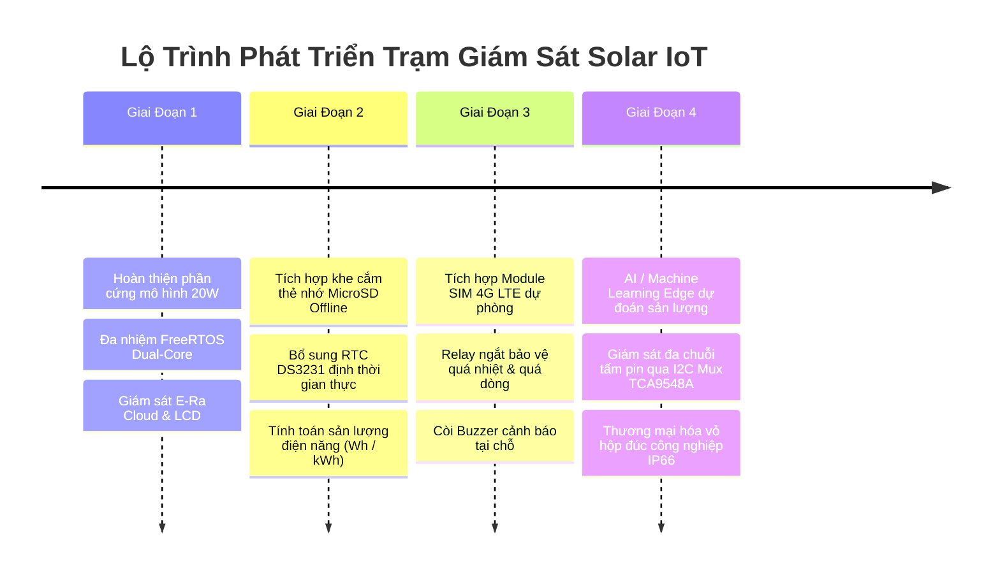

# ⚠️ Known Issues & Engineering Limitations — Giới Hạn & Lộ Trình Khắc Phục

Tài liệu này công khai minh bạch toàn bộ các giới hạn kỹ thuật, sai số phần cứng đã biết và lộ trình nâng cấp hệ thống **Solar-Smart-IOT** cho cộng đồng mã nguồn mở.

---

## 1. Các Giới Hạn Kỹ Thuật Đã Xác Minh

### 1.1. Bản chất quy đổi quang thông của cảm biến BH1750
* **Vấn đề:** BH1750 là cảm biến đo độ rọi ánh sáng khả kiến (Photopic Illuminance trong dải bước sóng $\approx 380\text{ nm} - 780\text{ nm}$), đáp ứng theo mắt người, không phải thiết bị đo toàn phổ bức xạ nhiệt mặt trời chuyên dụng (Pyranometer đo từ $300\text{ nm} - 3000\text{ nm}$).
* **Ảnh hưởng:** Hệ số quy đổi thực nghiệm $G = \text{Lux} / 120.0$ ($\text{W/m}^2$) có độ chính xác cao vào buổi trưa nắng quang mây. Tuy nhiên vào sáng sớm, hoàng hôn hoặc ngày trời mù nhiều tầng mây tán xạ, tỷ lệ phổ hồng ngoại/tử ngoại thay đổi khiến giá trị bức xạ ước tính có thể sai lệch $\pm 10\% \div 15\%$ so với máy đo nhiệt chuẩn.
* **Biện pháp xử lý hiện tại:** Hệ thống đã cài đặt bộ lọc ngưỡng tối thiểu $G \ge 10\text{ W/m}^2$ để triệt tiêu số liệu rác khi thiếu sáng.
* **Hướng khắc phục dài hạn:** Thay thế hoặc bổ sung cảm biến bức xạ dùng diode quang phổ rộng Silicon chuyên dụng hoặc cảm biến nhiệt điện (Thermopile pyranometer).

### 1.2. Chưa có cơ chế lưu trữ ngoại tuyến (Offline Data Logging / Store-and-Forward)
* **Vấn đề:** Dữ liệu cảm biến được truyền trực tiếp từ RAM vi điều khiển ESP32 lên máy chủ E-Ra Cloud qua giao thức MQTT. Khi mạng Wi-Fi bị ngắt quãng, Core 0 sẽ chuyển sang trạng thái chờ kết nối lại.
* **Ảnh hưởng:** Mặc dù màn hình LCD tại Core 1 vẫn tiếp tục hiển thị thông số tại chỗ bình thường, toàn bộ dữ liệu đo đạc trong khoảng thời gian mất Internet sẽ không được lưu trữ và không thể bù lại vào đồ thị lịch sử đám mây.
* **Hướng khắc phục:** Tích hợp module thẻ nhớ MicroSD qua giao tiếp SPI hoặc tận dụng bộ nhớ Flash SPIFFS/LittleFS có sẵn của ESP32 để ghi buffer vòng (Circular Ring Buffer), tự động tải bù (Sync back) lên Cloud khi kết nối phục hồi.

### 1.3. Dung sai và hệ số trôi nhiệt của điện trở Shunt INA226
* **Vấn đề:** Các module cảm biến INA226 thương mại phổ biến trên thị trường sử dụng điện trở shunt dán kích thước SMD 2512 trị số $0.1\Omega$ (R100) với sai số tiêu chuẩn $1\% \div 5\%$.
* **Ảnh hưởng:** Khi tải tiêu thụ dòng lớn kéo dài, nhiệt độ trên điện trở shunt tăng lên, gây ra hiện tượng trôi nhiệt trở kháng (Temperature Coefficient of Resistance - TCR), dẫn đến sai số dòng điện $\pm 2\% \div 3\%$ nếu không được hiệu chỉnh nhiệt.
* **Khuyến nghị:** Đối với các ứng dụng công nghiệp, nên thay thế shunt trên module bằng điện trở shunt hợp kim chuyên dụng Manganin hoặc Vishay Dale có sai số $0.1\%$ và TCR $< 20\text{ ppm/}^\circ\text{C}$.

### 1.4. Tính toán điện năng tích lũy (Energy Wh Integration)
* **Vấn đề:** Firmware phiên bản hiện tại tập trung xử lý và hiển thị công suất tức thời ($P_{\text{PV}}$ theo Watt). Công thức tích phân điện năng theo thời gian ($E = \int P dt$ Wh) chưa được tích hợp lưu định kỳ vào bộ nhớ không bay hơi (NVS).
* **Ảnh hưởng:** Khi ESP32 mất nguồn hoặc khởi động lại, biến tích lũy điện năng bị reset về 0.

---

## 2. Lộ Trình Phát Triển & Mở Rộng Hệ Thống (Roadmap)

### Kế hoạch chi tiết theo các giai đoạn:
* **Ngắn hạn (1 - 3 tháng):**
  - [ ] Bổ sung module thẻ nhớ MicroSD SPI lưu trữ dữ liệu dạng CSV chuẩn.
  - [ ] Tích hợp IC thời gian thực RTC DS3231 duy trì dấu thời gian chính xác khi mất mạng.
  - [ ] Lưu điện năng tích lũy ($Wh$) vào Flash NVS định kỳ 5 phút/lần.
* **Trung hạn (3 - 6 tháng):**
  - [ ] Thêm relay bảo vệ cách ly tải khi điện áp pin lưu trữ xuống dưới ngưỡng an toàn ($10.5\text{V}$).
  - [ ] Hỗ trợ cấu hình Wi-Fi và Token E-Ra qua trang Web Captive Portal (WiFiManager) mà không cần nạp lại mã nguồn.
  - [ ] Bổ sung module cảm biến môi trường đo độ ẩm và áp suất khí quyển (BME280 / SHT30).
* **Dài hạn (6 - 12 tháng):**
  - [ ] Mở rộng hệ thống giám sát trạm phát quy mô lớn (vài kW) bằng bộ ghép kênh I2C TCA9548A để điều khiển 8 cặp INA226 độc lập.
  - [ ] Xây dựng mô hình hồi quy Machine Learning phân tích độ bám bụi bề mặt và tự động nhắc nhở vệ sinh tấm pin.
