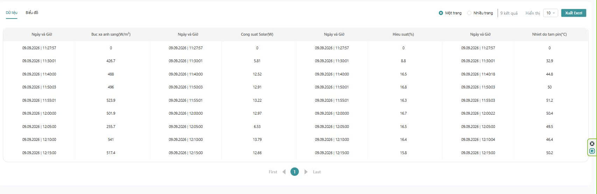

# 🧪 Testing & Verification — Báo Cáo Kiểm Thử & Dữ Liệu Thực Nghiệm

Tài liệu này tổng hợp toàn bộ quy trình kiểm thử, phương pháp đánh giá sai số và bảng dữ liệu đo đạc thực tế của hệ thống **Solar-Smart-IOT** thu thập từ thực nghiệm ngoài trời tại Thái Nguyên.

---

## 1. Phương Pháp & Kịch Bản Kiểm Thử

Quá trình kiểm thử được triển khai theo 3 giai đoạn độc lập:

1. **Giai đoạn 1: Kiểm thử tĩnh & Đo thông mạch (Static Bench Test)**
   * Dùng thang đo ôm kế và thông mạch (Beep test) kiểm tra toàn bộ mối hàn, cọc domino và chân cắm ESP32.
   * Cấp nguồn qua Mini360, kiểm tra điện áp đầu ra không vượt quá $5.05\text{V}$.
   * Quét địa chỉ bus I2C xác nhận đủ 4 thiết bị: `0x23` (BH1750), `0x27` (LCD1602), `0x40` (INA226 Batt), `0x41` (INA226 Solar).

2. **Giai đoạn 2: Kiểm thử chức năng nhúng & Đa nhiệm FreeRTOS (Embedded Stress Test)**
   * Kiểm tra khả năng đáp ứng của 4 nút nhấn điều hướng: thời gian lọc rung (debounce) $500\text{ ms}$, chuyển 5 trang màn hình LCD không bị đơ hoặc nhảy trang.
   * Thử nghiệm ngắt kết nối Wi-Fi đột ngột: Xác nhận tác vụ đọc cảm biến và hiển thị LCD tại Core 1 vẫn hoạt động liên tục với chu kỳ $500\text{ ms} / 1000\text{ ms}$ mà không bị treo hệ thống.

3. **Giai đoạn 3: Kiểm thử thực nghiệm ngoài trời (Outdoor Solar Field Test)**
   * **Địa điểm:** Ngoài trời tự nhiên tại khu vực TP. Thái Nguyên.
   * **Đối tượng:** Tấm pin mặt trời Polycrystalline 20W kết hợp khối sạc MPPT và pin lưu trữ 3S 18650, cấp điện cho quạt DC 5V.
   * **Thời gian ghi nhận số liệu:** Ngày 09/09/2026, từ 11:30 đến 12:15 trưa (thời điểm cường độ bức xạ và góc chiếu sáng tối ưu nhất trong ngày).

---

## 2. Bảng Dữ Liệu Thực Nghiệm Thu Thập Trên E-Ra Cloud

Dưới đây là chuỗi dữ liệu thực tế được ghi nhận liên tục từ hệ thống và xuất từ lịch sử đo đạc của nền tảng E-Ra IoT:

| Thời Gian | Bức Xạ Mặt Trời ($G$ - $\text{W/m}^2$) | Công Suất Phát ($P_{\text{PV}}$ - $\text{W}$) | Hiệu Suất Chuyển Đổi ($\eta$ - $\%$) | Nhiệt Độ Tấm Pin ($T_{\text{Panel}}$ - $^\circ\text{C}$) | Trạng Thái Thời Tiết / Ghi Chú |
|:---:|:---:|:---:|:---:|:---:|:---|
| **11:30** | 426.7 | 5.81 | 8.8% | 32.9 | Khởi động đo, góc chiếu nghiêng ban đầu |
| **11:40** | 488.0 | 12.52 | 16.5% | 44.8 | Nắng đều, MPPT bám điểm công suất cực đại |
| **11:50** | 496.0 | 12.91 | 16.8% | 50.0 | Nắng gắt, nhiệt độ tấm pin tăng nhanh |
| **11:55** | 523.9 | 13.22 | 16.3% | 51.2 | Đỉnh bức xạ đợt 1, nhiệt độ đạt trên 51°C |
| **12:00** | 501.9 | 12.97 | 16.7% | 50.4 | Nắng ổn định, hiệu suất giữ vững > 16.5% |
| **12:05** | **255.7** | **6.53** | **16.5%** | **49.5** | **Hiện tượng mây che đột ngột (Bức xạ giảm 49%)** |
| **12:10** | **541.0** | **13.79** | **16.4%** | **46.4** | **Đỉnh công suất cực đại trong đợt thử nghiệm (13.79W)** |
| **12:15** | 517.4 | 12.66 | 15.8% | 50.2 | Nắng duy trì, nhiệt độ tiếp tục ở mức 50.2°C |

---

## 3. Phân Tích & Đánh Giá Kết Quả Đo Đạc

### 3.1. Phản ứng công suất tức thời trước sự biến thiên bức xạ
* Từ dữ liệu lúc **12:05**, khi xuất hiện đám mây che khuất mặt trời, cường độ bức xạ đo bởi BH1750 giảm ngay từ $501.9\text{ W/m}^2$ xuống $255.7\text{ W/m}^2$ (mức sụt giảm **$49.0\%$**).
* Đồng thời, công suất điện phát ra của tấm pin đo bởi cảm biến INA226 giảm tương ứng từ $12.97\text{ W}$ xuống $6.53\text{ W}$ (mức giảm **$49.6\%$**).
* Tỷ lệ sụt giảm gần như đồng dạng $1:1$ chứng minh cảm biến bức xạ BH1750 và cảm biến đo công suất INA226 có độ đáp ứng thời gian thực rất nhanh, thuật toán bám sát biến thiên môi trường.

### 3.2. Đánh giá hiệu suất chuyển đổi quang - điện ($\eta\%$)
* Sau mốc khởi động lúc 11:30, khi tấm pin đạt trạng thái làm việc ổn định (11:40 đến 12:15), hiệu suất tính toán duy trì đều đặn trong dải **$15.8\% \div 16.8\%$**.
* Giá trị này hoàn toàn tương thích với thông số kỹ thuật lý thuyết của công nghệ pin Polycrystalline thương mại (thường đạt từ $15\% \div 18\%$).
* Độ ổn định của chỉ số hiệu suất khẳng định diện tích hiệu dụng khai báo ($S = 0.155\text{ m}^2$) và hệ số quy đổi quang thông ($\text{Lux} / 120 = \text{W/m}^2$) có độ chính xác thực nghiệm cao.

### 3.3. Tác động của nhiệt độ tấm pin ($T_{\text{Panel}}$)
* Trong suốt 45 phút phơi nắng liên tục, nhiệt độ bề mặt sau tấm pin đo bởi DS18B20 tăng từ $32.9^\circ\text{C}$ lên $51.2^\circ\text{C}$ (tăng $+18.3^\circ\text{C}$).
* Dữ liệu ghi nhận cho thấy tại cùng mức bức xạ xấp xỉ $\approx 517 - 523\text{ W/m}^2$, hiệu suất ở nhiệt độ $51.2^\circ\text{C}$ giảm nhẹ từ $16.5\%$ xuống $15.8\%$, phù hợp với hệ số suy giảm nhiệt độ tiêu chuẩn của pin mặt trời silic ($\approx -0.4\% / ^\circ\text{C}$).

---

## 4. Hình Ảnh Bằng Chứng Dữ Liệu & Biểu Đồ Thực Tế

| Bảng Dữ Liệu Thu Thập Trên E-Ra | Biểu Đồ Lịch Sử E-Ra | Giao Diện Giám Sát Web E-Ra |
|:---:|:---:|:---:|
|  |  |  |

### Biểu Đồ Xu Hướng Theo Thời Gian
* **Biểu đồ điện áp tấm pin:** [`chart_voltage_vs_time.png`](images/chart_voltage_vs_time.png) — Ghi nhận điện áp làm việc ổn định trong dải $15.2\text{V} \div 17.2\text{V}$ do mạch MPPT điều khiển.
* **Biểu đồ dòng điện tấm pin:** [`chart_current_vs_time.png`](images/chart_current_vs_time.png) — Biến thiên tuyến tính theo bức xạ mặt trời.
* **Biểu đồ công suất phát:** [`chart_power_vs_time.png`](images/chart_power_vs_time.png) — Đạt đỉnh $13.79\text{ W}$ tại bức xạ $541\text{ W/m}^2$.
