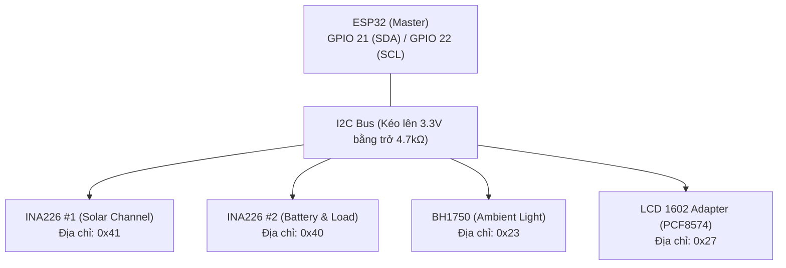

# 🔌 Wiring & Pinout Guide — Hướng Dẫn Đấu Nối Phần Cứng

Tài liệu này cung cấp sơ đồ nguyên lý đấu nối chi tiết, ma trận phân bổ chân vi điều khiển (Pinout Matrix), hướng dẫn lắp đặt mạch công suất và các khuyến nghị an toàn điện tử cho dự án **Solar-Smart-IOT**.

---

## 1. Sơ Đồ Khối Đấu Nối Hệ Thống (System Schematic)

Hệ thống được chia thành 4 phân vùng mạch chức năng:
1. **Phân vùng động lực công suất (Power Distribution & Sensing):** Tấm pin PV, Bộ sạc MPPT, Khối pin lưu trữ 3S Lithium, Module hạ áp Mini360 và 2 cảm biến shunt INA226.
2. **Phân vùng điều khiển trung tâm (Core MCU):** ESP32 DevKit V1 30-pin.
3. **Phân vùng cảm biến môi trường (Environmental Sensing):** BH1750 (Độ rọi / Bức xạ) và DS18B20 (Nhiệt độ bề mặt).
4. **Phân vùng giao tiếp người dùng tại chỗ (Local UI):** Màn hình LCD1602 I2C và cụm 4 nút nhấn nhả điều hướng.

---

## 2. Ma Trận Đấu Nối Chân ESP32 (Pinout Matrix)

| Chân ESP32 | Tên Tín Hiệu | Thiết Bị Ngoại Vi | Mức Điện Áp | Kiểu Cấu Hình | Ghi Chú Kỹ Thuật |
|:---:|:---:|:---|:---:|:---:|:---|
| **GPIO 21** | `I2C_SDA` | INA226 #1, INA226 #2, BH1750, LCD1602 | 3.3V | I2C Open-Drain | Tuyến bus dữ liệu số I2C chung |
| **GPIO 22** | `I2C_SCL` | INA226 #1, INA226 #2, BH1750, LCD1602 | 3.3V | I2C Open-Drain | Tuyến xung đồng hồ I2C chung |
| **GPIO 23** | `ONE_WIRE` | DS18B20 (Chân DQ/Data) | 3.3V | 1-Wire Bi-directional | **Bắt buộc:** Trở kéo $4.7\text{ k}\Omega$ lên 3.3V |
| **GPIO 17** | `BTN_NEXT` | Nút bấm SW1 (Trang tiếp theo) | 3.3V | `INPUT_PULLUP` | Tích cực mức THẤP (Active-LOW, nối GND khi nhấn) |
| **GPIO 5** | `BTN_PREV` | Nút bấm SW2 (Trang trước đó) | 3.3V | `INPUT_PULLUP` | Tích cực mức THẤP (Active-LOW, nối GND khi nhấn) |
| **GPIO 18** | `BTN_AUTOSCROLL` | Nút bấm SW3 (Bật/Tắt tự cuộn trang) | 3.3V | `INPUT_PULLUP` | Tích cực mức THẤP (Active-LOW, nối GND khi nhấn) |
| **GPIO 19** | `BTN_BACKLIGHT` | Nút bấm SW4 (Bật/Tắt đèn nền LCD) | 3.3V | `INPUT_PULLUP` | Tích cực mức THẤP (Active-LOW, nối GND khi nhấn) |
| **5V (VIN)** | `VCC_5V` | Đầu ra module hạ áp Mini360 | 5.0V | Nguồn vào DC | Cấp nguồn nuôi cho ESP32 và module LCD1602 |
| **GND** | `COMMON_GND` | Toàn bộ linh kiện và nguồn âm | 0V | Điểm tham chiếu chung | Điểm mass chung bắt buộc nối với nhau |

---

## 3. Bản Đồ Địa Chỉ I2C Trên Bus (I2C Address Map)

Toàn bộ các thiết bị giao tiếp số dùng chung 2 chân `GPIO 21 (SDA)` và `GPIO 22 (SCL)`:

> [!IMPORTANT]
> **Cấu hình địa chỉ phần cứng cho INA226:**
> - **INA226 số 1 (Đo Solar):** Chân `A0` nối `VCC`, chân `A1` nối `GND` $\rightarrow$ Địa chỉ I2C = `0x41`.
> - **INA226 số 2 (Đo Battery/Load):** Chân `A0` nối `GND`, chân `A1` nối `GND` $\rightarrow$ Địa chỉ I2C = `0x40`.
> - Nếu sử dụng module màn hình LCD có chip PCF8574AT (thay vì PCF8574T), địa chỉ có thể là `0x3F`. Hãy chạy chương trình `I2C Scanner` nếu màn hình không lên chữ.

---

## 4. Hướng Dẫn Đấu Nối Mạch Công Suất & Cảm Biến Shunt

### 4.1. Nhánh Tấm Pin Năng Lượng Mặt Trời (Solar Input)
1. Cực dương $(+)$ của tấm pin mặt trời đấu vào chân **`IN+`** của module INA226 #1.
2. Chân **`IN-`** của module INA226 #1 đấu vào cực dương đầu vào $(VIN+)$ của mạch sạc MPPT.
3. Cực âm $(-)$ của tấm pin mặt trời đấu trực tiếp vào cực âm đầu vào $(VIN-)$ của mạch sạc MPPT và nối về `GND` chung.
4. Chân `VBUS` của INA226 #1 nối chung với chân `IN+` để đo điện áp nguồn phát của tấm pin.

### 4.2. Nhánh Pin Lưu Trữ 3S & Nguồn Nuôi Mạch
1. Đầu ra cực dương $(BAT+)$ của mạch sạc MPPT đấu vào cực dương của bộ pin Lithium 3S (11.1V ~ 12.6V).
2. Đầu ra cực âm $(BAT-)$ của mạch sạc MPPT đấu vào cực âm của khối pin lưu trữ và nối về `GND` chung.
3. Từ cực dương $(BAT+)$ của pin lưu trữ:
   - **Đường 1 (Nuôi mạch):** Đi vào cực dương đầu vào $(IN+)$ của module hạ áp Mini360.
   - **Đường 2 (Cấp tải):** Đi vào chân **`IN+`** của module INA226 #2.
4. Chân **`IN-`** của INA226 #2 nối với cực dương của tải tiêu thụ (ví dụ: quạt tản nhiệt DC, bóng đèn hoặc cổng ra USB).

### 4.3. Module Hạ Áp Mini360 Cấp Nguồn Hệ Thống
1. Đầu vào $(IN+, IN-)$ nhận nguồn từ pin lưu trữ (9V - 12.6V).
2. Dùng tuốc-nơ-vít xoay biến trở vi chỉnh trên module Mini360, đo bằng đồng hồ vạn năng DMM tại đầu ra $(OUT+, OUT-)$ cho đến khi đạt chính xác **$5.00\text{ V} \pm 0.05\text{ V}$**.
3. Đầu ra $(OUT+)$ cấp vào chân **`5V` (hoặc `VIN`)** của ESP32 và chân **`VCC`** của module LCD1602.
4. Đầu ra $(OUT-)$ nối vào chân **`GND`** của toàn hệ thống.

---

## 5. Quy Chuẩn Màu Dây & Khuyến Nghị An Toàn Điện

* **Quy ước màu dây tiêu chuẩn:**
  * 🔴 **Đỏ:** Đường nguồn dương (+12V, +5V, +3.3V).
  * ⚫ **Đen:** Đường mass âm (GND chung).
  * 🟢 **Xanh lá / Vàng:** Tín hiệu I2C SDA / 1-Wire DQ.
  * 🔵 **Xanh dương / Trắng:** Tín hiệu I2C SCL.

> [!CAUTION]
> 1. **Kiểm tra điện áp Mini360 trước khi cắm ESP32:** Tuyệt đối không cắm ESP32 khi chưa chỉnh biến trở của Mini360. Nếu điện áp đầu ra vượt quá 5.5V, vi điều khiển ESP32 sẽ bị cháy nguồn hỏng vĩnh viễn.
> 2. **Phân cực Shunt INA226:** Đấu đúng chiều dòng điện từ `IN+` sang `IN-`. Nếu đấu ngược chiều, công suất đo được vẫn dương do thuật toán lấy giá trị tuyệt đối, nhưng cờ báo sạc/xả của pin lưu trữ sẽ bị đảo lộn (`DISCHARGING` thay vì `CHARGING`).
> 3. **Điện trở kéo 1-Wire:** Cảm biến DS18B20 bắt buộc phải có điện trở $4.7\text{ k}\Omega$ nối giữa chân tín hiệu vàng/trắng (DQ) và đường nguồn 3.3V. Nếu thiếu trở kéo, cảm biến sẽ trả về giá trị lỗi `-127.0°C`.
> 4. **Tránh ngắn mạch tấm pin:** Khi thao tác đấu nối ngoài trời có ánh nắng, hãy che bề mặt tấm pin bằng bìa carton hoặc vải tối màu để tránh phát sinh tia lửa điện tại các cọc đấu dây.
